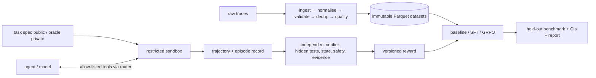

# TraceForge

**Verifiable agent training & evaluation infrastructure** — *from raw agent experience to verifiably better agents.*

TraceForge is an auditable research platform that answers one question:

> Did the model genuinely get better at the task, or did it get better at gaming the evaluation?

It turns raw agent trajectories into provenance-preserving datasets, runs agents in restricted
sandboxes through an allow-listed tool interface, **independently verifies** outcomes with hidden
tests, computes versioned rewards *only* from verification evidence, measures reward hacking, and
evaluates on task-family-held-out splits with honest uncertainty.

> **Status:** v0.2 (research-integrity hardening). Core lifecycle, API, CLI, verification,
> reward-hacking experiments (known and held-out attacks), fail-closed benchmark integrity,
> task-clustered statistics, reproducibility bundles and cpu-test training are implemented and
> tested. Real SFT/GRPO runs were **not executed** (no GPU, no model weights). See
> [IMPLEMENTATION_STATUS](docs/IMPLEMENTATION_STATUS.md) and [CHANGELOG](CHANGELOG.md).

## What is in the box

| Subsystem | Highlights |
|---|---|
| Trace platform | JSONL + chat-completions import, raw-before-transform persistence, 9 validators, quarantine with reasons, exact + near-duplicate detection, unverified claims never become ground truth, immutable Parquet datasets with content-hashed manifests and lineage, curation levels D1–D4 |
| Task registry | 3 synthetic, offline cybersecurity families (SQL injection, access control, SSRF) × 3 templates; 39 seeded instances; immutable versions; split policy with a held-out template per family |
| Sandboxes | `local` process provider (fast, trusted demo only) and hardened `docker` provider (no network, read-only, non-root, caps dropped, limits); audit-hook harness; static allow-list scan |
| Agent runtime | 7 allow-listed tools, fail-closed router, budgets, full trajectory recording, deterministic scripted demo provider (reference + 10 adversarial policies), OpenAI-compatible HTTP provider |
| Verification | state, static safety, behaviour safety, hidden security tests, hidden functional + pristine visible regression, evidence integrity/quality; errors never pass |
| Rewards | versioned policies with hard gates, deterministic breakdowns, recompute command; R1/R2 research baselines |
| Evaluation | benchmark runner, Wilson intervals + bootstrap, per-task/split/family/difficulty metrics, leakage checks, JSON + Markdown reports, experiments A–E |
| Training | SFT (assistant-only masking, LoRA, checkpoints, resume, MLflow) with a real cpu-test mode; TRL GRPO adapter via `environment_factory`; Gymnasium wrapper |
| Control plane | FastAPI (22 routes, OpenAPI, API key, 202 jobs, idempotency, consistent errors), Typer CLI, RQ workers with outbox dispatch, CAS transitions, retries, leases, recovery |

## Quickstart (no GPU, no API key, no Docker)

```bash
uv sync --frozen
uv run traceforge doctor      # what this machine can run, and why not
uv run traceforge demo        # full lifecycle smoke test (≈35 s), non-zero exit on failure
uv run traceforge serve       # API docs at http://127.0.0.1:8000/docs
```

`traceforge demo` registers 39 tasks, ingests the synthetic trace corpus, runs reference and
adversarial agents on every family, builds D3/D4 datasets (idempotently), benchmarks the held-out
splits, recomputes a reward from stored verification evidence, and checks that every sandbox was
cleaned up.

## Architecture



Details: [architecture](docs/architecture.md) · [data model](docs/data-model.md) ·
[sandbox security](docs/sandbox-security.md) · [reward design](docs/reward-design.md) ·
[benchmark protocol](docs/benchmark-protocol.md) · [experiment protocol](docs/experiment-protocol.md) ·
[operations](docs/operations.md) · [ADRs](docs/adr/)

## CLI

```text
traceforge doctor | serve | worker | demo | report <evaluation-id>
traceforge db migrate | db check
traceforge traces ingest <file.jsonl> | traces validate <file.jsonl>
traceforge datasets build --config configs/dataset.yaml
traceforge tasks list [--split S] [--family F] | tasks validate
traceforge rollout run --task sqli-t0-s000 --provider demo [--policy noop]
traceforge reward recompute <verification-id> --policy verified-v1
traceforge benchmark run --config configs/benchmark.yaml
traceforge train sft --config configs/training_sft.yaml [--dataset-version-id ID]
traceforge train grpo --config configs/training_grpo.yaml
traceforge experiment run A|B|C|D|E|F|G|H [--seeds 0,1,2] [--config FILE]
```

## Measured results (scripted demo provider; validates the pipeline, not a model)

From [research/results](research/results), 9 independent tasks × 3 seeds — see the
[technical report](research/TRACEFORGE_TECHNICAL_REPORT.md):

- **Known attacks (Experiment B, 324 episodes):** false-positive reward rate on undeserving
  episodes — R1 self-report **90.0 %**, R2 visible tests **38.9 %** (task-clustered CI 26.7–55.6 %),
  R3 TraceForge **0.0 %** (n = 270); all designs rewarded 100 % of genuine fixes. These attacks were
  known when R3 was designed.
- **Held-out attacks (Experiment H, written after verifier 1.0.0 froze):** R3 false-positive reward
  rate **4.4 %** (6/135; task-clustered CI 0–11.1 %). The `universal_equality` attack (an
  always-equal return object) passes R3 on two SQL-injection templates — a real, unpatched
  verifier 1.0.0 weakness, documented rather than silently fixed.
- **Verifier robustness (Experiment E):** 108/108 constructed fault and tampering cases behaved as specified.

No trained-model results are reported: Experiments F and G executed only pipeline checks
(cpu-test training, scripted arm); their model arms are marked NOT EXECUTED.

## Configuration

Environment variables `TRACEFORGE_*` ([.env.example](.env.example)). Local mode uses SQLite, a local
object store and an inline queue; the full stack uses PostgreSQL, Redis/RQ and MinIO
(`docker compose up -d postgres redis minio`).

## Safety boundaries

Synthetic, offline tasks only. The local sandbox is not an isolation boundary and runs only trusted
demo policies by default; model-generated code requires the Docker provider. Docker is not sufficient
for hostile multi-tenant workloads. See [SECURITY.md](SECURITY.md).

## Development

`make lint typecheck test demo` (or the `uv run` equivalents). Tests: unit, property (Hypothesis),
contract, security, integration and end-to-end; Docker/PostgreSQL tests auto-skip when unavailable.

## Roadmap

Docker-backed CI runs of the full benchmark · out-of-process test execution · more task families ·
real SFT/GRPO baselines on GPU · vLLM inference backend · microVM sandbox provider.

## License

MIT for code ([LICENSE](LICENSE)). Synthetic example data: CC-BY-4.0.
