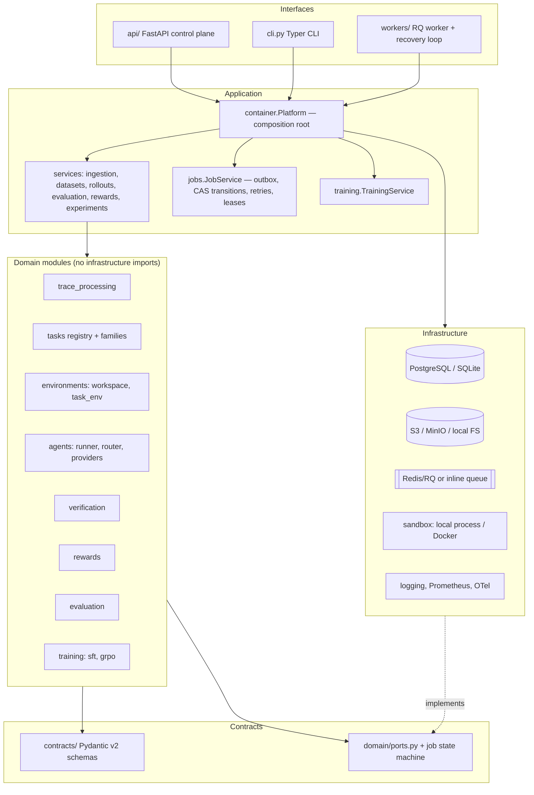
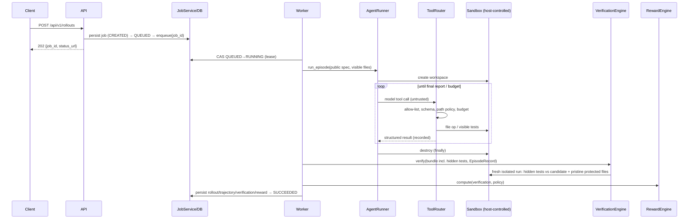

# Architecture

TraceForge is a **modular monolith** (domain + application logic in one package) with separate
**worker processes** for long-running jobs. Infrastructure is reached only through ports.

## Layers and dependency direction

Rules enforced by construction:

- `modules/*` import only `contracts`, `domain` and other modules — never SQLAlchemy, boto3, Redis,
  Docker or Transformers at module import time (training imports ML libraries lazily inside functions).
- `RewardEngine` is a pure function of `(VerificationResult, RewardPolicy)`.
- `AgentRunner` receives only the public `TaskSpec` + visible files and **never decides success**.
- `VerificationEngine` reads host-recorded `EpisodeRecord` facts plus oracle data; it never trusts
  agent-supplied labels.
- Route handlers translate HTTP ⇄ services; no domain logic in `api/`.

## Rollout sequence

## Trust boundaries

| Boundary | Untrusted side | Controls |
|---|---|---|
| Model output → environment | tool calls, arguments, patches | ToolRouter allow-list, Pydantic schemas, path policy, size/budget limits, protected files |
| Candidate code → host | code executed by tests | Docker provider (no network, read-only, non-root, caps dropped, limits); local provider restricted to trusted demo policies; static allow-list scan before verification; audit-hook guard |
| Agent claims → outcomes | final report, evidence explanations | verdict from hidden tests + state/safety checks; evidence IDs checked against host records |
| Imported traces → datasets | outcome labels, hashes, verification refs | claims kept as `claimed_outcome`; content hash recomputed; dangling verification refs rejected |
| API clients → control plane | requests | API key (mandatory in prod), strict schemas (`extra="forbid"`), size limits, consistent errors |

## Persistence

- Operational metadata in PostgreSQL (SQLite for local/test). 20 tables, Alembic migration `0001`.
- Large/immutable artifacts (raw traces, episode records, Parquet partitions, reports, checkpoints,
  oracle bundles) in object storage, content-addressed, with SHA-256 recorded in `artifacts`.

## Jobs

`CREATED → QUEUED → RUNNING → SUCCEEDED | FAILED | TIMED_OUT | CANCELLED` (plus `RUNNING → QUEUED`
for bounded retries). Transitions are compare-and-set on `(status, version)`. See ADR-010.
