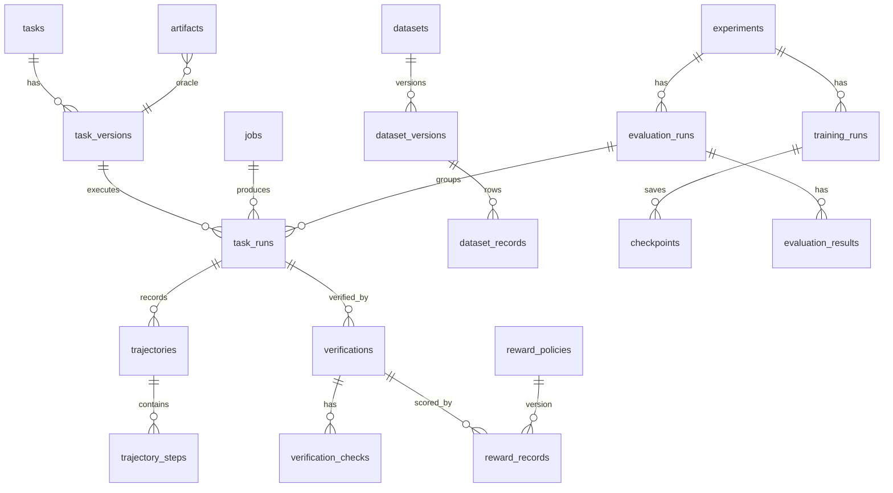

# Data model

## Contracts (Pydantic v2, `extra="forbid"`, UTC-aware timestamps, UUID ids)

| Contract | File | Notes |
|---|---|---|
| `Trajectory`, `TrajectoryStep` | `contracts/traces.py` | schema_version `1.0`; strictly increasing sequence numbers; `SUCCESS` requires `verification_id`; unverified claims live in `claimed_outcome`; `content_hash` excludes ids/timestamps |
| `TaskSpec` (public) / `TaskOracleSpec` (private) / `TaskBundle` | `contracts/tasks.py` | the oracle is never serialised into prompts, observations or workspaces |
| `ToolCall`, tool inputs, `ToolResult` | `contracts/actions.py` | each tool input is a strict schema |
| `EpisodeRecord` | `contracts/observations.py` | host-recorded facts: final files, original hashes, test runs, patches, evidence, rejected actions |
| `VerificationResult`, `VerificationCheck` | `contracts/verification.py` | PASS/FAIL/PARTIAL/INCONCLUSIVE/ERROR; per-check reason codes and evidence hashes |
| `RewardPolicy`, `RewardBreakdown` | `contracts/rewards.py` | weights sum to 1; efficiency ≤ completion; required gates for non-research policies |
| `DatasetManifest`, `QualityReport` | `contracts/datasets.py` | immutable, content-hashed |
| `JobView` + transition table | `contracts/jobs.py` | |
| `RolloutSummary`, `BenchmarkConfig`, `ProviderConfig` | `contracts/experiments.py` | |

## Database (Alembic revision `0001`)

Also: `quarantine_records` (invalid raw records with reasons) and `artifacts` (uri, sha256, size,
media type, kind). Integrity-sensitive fields are typed columns; JSON(B) holds immutable documents
(spec, verification, reward breakdown, manifest) and flexible metadata only. Unique constraints
enforce immutability/idempotency: `(task_pk, version)`, `(policy_id, version)`,
`(verification_id, policy_pk, calculation_version)`, `dataset_versions.content_hash`,
`jobs.idempotency_key`, `(trajectory_id, sequence_number)`.

## Object storage layout

| Prefix | Content |
|---|---|
| `raw/traces/<sha[:2]>/<sha>.jsonl` | raw ingested bytes, persisted before normalisation |
| `oracle/<sha[:2]>/<sha>.json` | private oracle + hidden tests (restricted prefix) |
| `episodes/<sha[:2]>/<sha>.json` | immutable `EpisodeRecord` per rollout (enables re-verification) |
| `datasets/<name>/<version>/{train,validation}.parquet, manifest.json, quality_report.md` | dataset versions |
| `reports/<evaluation_id>/report.{json,md}` | benchmark reports |
| `checkpoints/<training_run_id>/step-N/...` | checkpoints + metadata |

Objects are write-once: re-writing a key with different bytes raises a conflict.

## Lineage

`dataset_records` → `trajectories` (id + content hash) → `task_runs` → `task_versions`
(`fixture_hash`, `generator_version`, `seed`, split) and → `verifications` → `reward_records`
(policy hash). A manifest lists every `(trajectory_id, content_hash)` source and the transformation
id/version, split policy and partition hashes.
